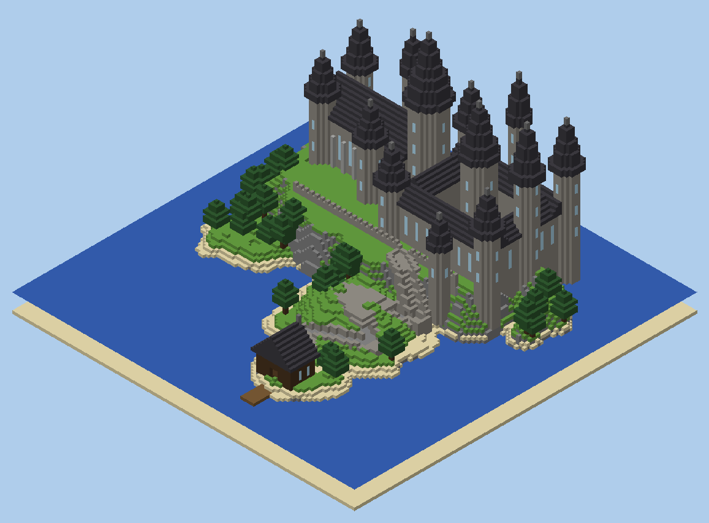

# Minecraft Education ⇄ Mac Terminal Bridge

Drive **Minecraft Education** from your **Mac terminal** through a small Node.js backend, and build a
Hogwarts-style castle on an island with a single command.



```
┌──────────────────────┐  /connect (WebSocket)  ┌────────────────────┐   HTTP + SSE    ┌──────────────┐
│ Minecraft Education  │ ─────────────────────▶ │  Backend bridge    │ ◀────────────── │  mc  (Mac    │
│ (your world)         │ ◀── commands / events ─│  ws :3000 api :3001│ ──── events ──▶ │  terminal)   │
└──────────────────────┘                        └────────────────────┘                 └──────────────┘
```

## 1. Install (once)

You need [Node.js 18+](https://nodejs.org) (`brew install node`).

```bash
git clone <this repo> && cd lovable-demo
npm install
cp .env.example .env   # optional: change ports, add a token
```

## 2. Start the backend (Terminal window 1)

```bash
npm start
```

## 3. Connect Minecraft Education

1. Open Minecraft Education, then go to **Settings → General** and turn **Enable Websockets** on.
   If you see **Require Encrypted Websockets**, turn it off.
2. Open (or create) a Creative world with **Activate Cheats** enabled.
3. Press `T` to open chat and type:

   ```
   /connect localhost:3000
   ```

   Minecraft replies "Connection established", and the backend prints `Minecraft connected`.

## 4. Control it from the Mac terminal (Terminal window 2)

```bash
npm run cli                   # interactive shell with live chat
npm run cli -- say hello      # one command
npm run cli -- build castle   # build the castle 70 blocks north of where you stand
npm run cli -- status
```

Inside the interactive shell you can type any Minecraft command without the `/`:

```
minecraft> time set day
minecraft> weather clear
minecraft> give @s diamond_sword
minecraft> build castle
```

To get a global `mc` command, run `npm link` once.

### Building the castle

Stand on open ground, face north, and run `build castle`. The build:

* clears a 129 × 129 area and fills it with a lake
* raises a cliff island and puts a castle on it: a great hall, a courtyard block, 13 spired towers and a battlemented terrace
* adds a zig-zag stone stairway down to a boathouse with a dock, plus spruce trees on the slopes
* teleports you to a viewpoint when it finishes (about 5,900 commands, usually 1–3 minutes)

The build **replaces everything** in that area, so use a fresh world or a spot you don't mind losing.
If some commands fail with errors about unloaded areas, raise your **Render Distance** to 12 or more
and run the build again from the same spot.
You can also pin the location: `build castle --at <x> <y> <z>`.

## HTTP API (for scripts and AI agents)

| Method | Path        | Body                                  |
|--------|-------------|---------------------------------------|
| GET    | `/health`   | –                                     |
| POST   | `/command`  | `{ "command": "say hi" }`             |
| POST   | `/commands` | `{ "commands": ["say a", "say b"] }`  |
| GET    | `/events`   | Server-Sent Events (chat, blocks…)    |

```bash
curl -X POST localhost:3001/command -H 'content-type: application/json' -d '{"command":"say hi from curl"}'
```

If you set `API_TOKEN` in `.env`, send `Authorization: Bearer <token>`. The CLI does this for you.
By default everything binds to `127.0.0.1`, so nothing outside your Mac can reach it.
If Minecraft runs on a different computer, set `HOST=0.0.0.0` and an `API_TOKEN`, then use `/connect <mac-ip>:3000`.

## Project layout

```
src/minecraft-bridge.js   WebSocket server Minecraft connects to; command queue + events
src/api.js                HTTP API + SSE event stream
src/server.js             starts both
src/builder.js            fill/setblock helpers (auto-splits fills over 32,768 blocks)
src/structures/castle.js  the castle generator
bin/mc.js                 terminal CLI
scripts/preview.py        renders a structure's commands to an isometric PNG
test/                     end-to-end tests against a fake Minecraft client
```

Adding another structure means writing a function that returns a `Builder`, then registering it in `STRUCTURES` in `bin/mc.js`.
