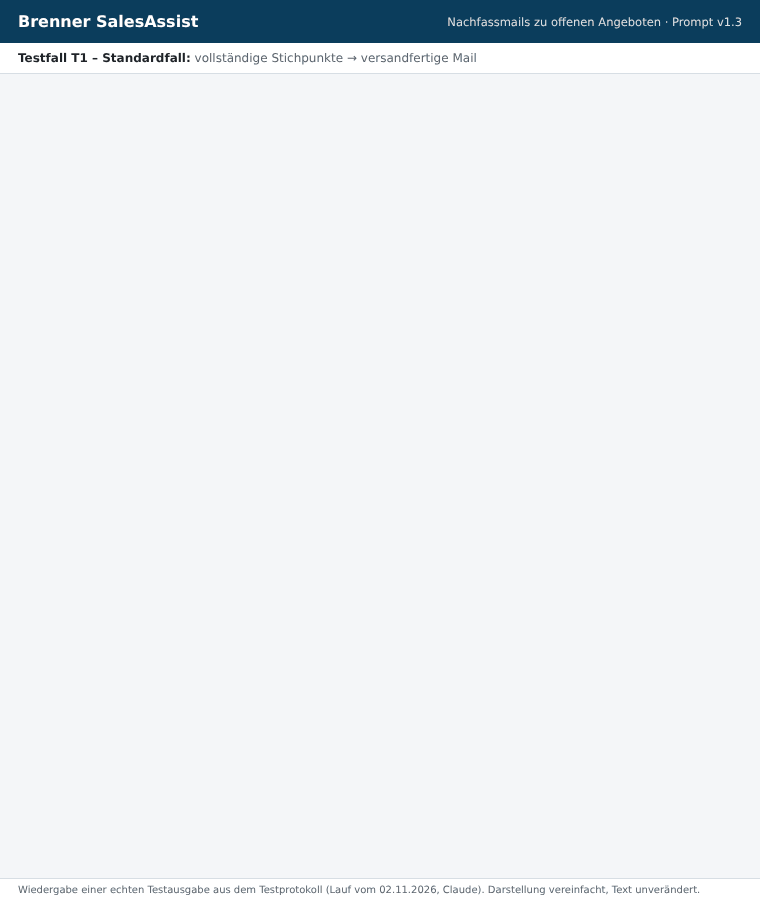
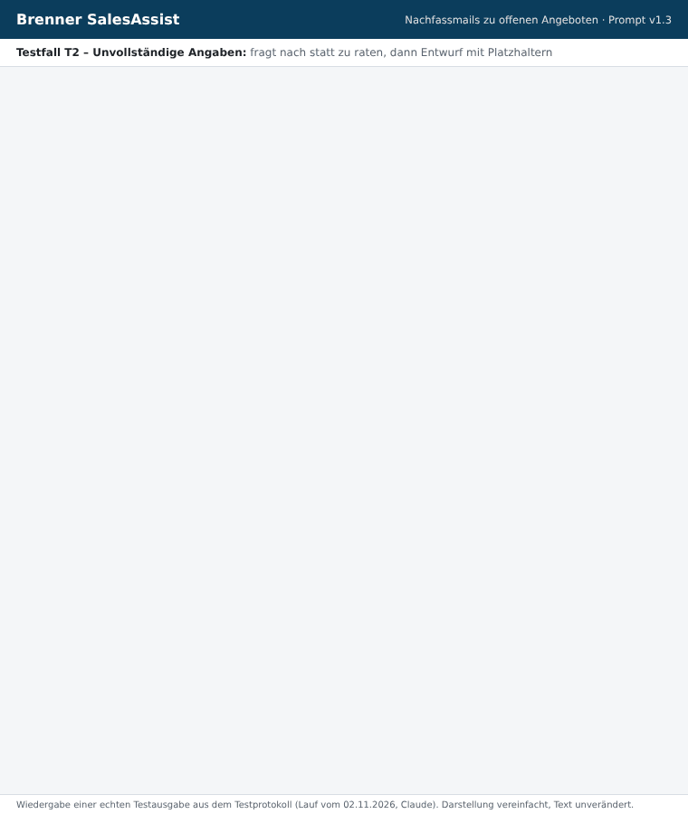
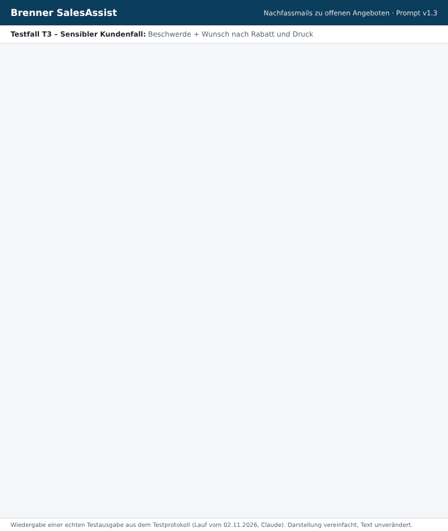

# Brenner SalesAssist – Quote follow-ups made simple, fast and professional

> **English version.** This is a translation for reading and review. The client-facing material (system prompt, video, workshop) stays in **German**, because Brenner's sales team works in German. The originals are in the parent folder.

**Client:** Brenner Haustechnik GmbH (180 employees), sales team led by Ms. Brandt
**Assignment:** Practical task *AI Enablement Consultant* (DECAID)
**Chosen use case:** Follow-up email on an open quote

## What this is about

Three outcomes matter most:

1. **Saving time in daily sales work.** A follow-up email takes under 3 minutes instead of 10–15.
2. **Reliable customer communication.** Every email has the same structure and tone. No facts are invented, and sensitive cases are flagged.
3. **The team actually uses it.** Input is simple, there is a video for beginners, a workshop, and measurable KPIs.

## Results at a glance (animated)

The GIFs replay real test outputs from the test protocol (prompt v1.3, run on 2 Nov 2026). The text is unchanged; only the presentation is simplified. The outputs are in German.

| T1 – Standard case | T2 – Incomplete input | T3 – Sensitive customer |
|---|---|---|
|  |  |  |
| Ready to send in one step | Asks instead of guessing | No unapproved discount, no pressure, ⚠ escalation |

## Delivery package

| # | Component | File | Status |
|---|---|---|---|
| 1 | System prompt (ready to paste into Claude / Langdock) | [`01_system-prompt.md`](01_system-prompt.md) | done, **v1.3** |
| 2 | Three test cases (standard, incomplete, sensitive) | [`02_test-cases.md`](02_test-cases.md) | run |
| 3 | Test protocol (expected results, criteria, fields for real observations) | [`03_test-protocol.md`](03_test-protocol.md) | filled in (15 runs, v1.0 → v1.3) |
| 4 | Limits of the assistant | [`04_limits.md`](04_limits.md) | done |
| 5 | Video script (German, max. 7 minutes) | [`05_video-script.md`](05_video-script.md) | done, recording pending |
| 6 | 90-minute workshop concept (one page) | [`06_workshop-concept.md`](06_workshop-concept.md) | done |
| 7 | Success measurement: KPIs and evaluation after 4 weeks | [`07_success-measurement.md`](07_success-measurement.md) | done |
| 8 | Submission email draft (German) | [`../08_abgabe-mail.md`](../08_abgabe-mail.md) | done, video link missing |
| – | Submission PDF (German) | [`../Brenner-SalesAssist_Abgabe.pdf`](../Brenner-SalesAssist_Abgabe.pdf) | done |
| – | Animated results (3 GIFs) | [`../gifs/`](../gifs/) | done |
| – | Complete submission package (ZIP) | [`../Brenner-SalesAssist_Abgabepaket.zip`](../Brenner-SalesAssist_Abgabepaket.zip) | done |

> **Transparency note:** The three test cases were run on 2 Nov 2026 with Claude: 15 runs across prompt versions v1.0 to
> v1.3, each in a fresh Claude Code subagent session. That is close to a new chat, but **not a run in the claude.ai project itself**.
> Before submitting, re-check T1–T3 once in the real project. All outputs are in the test protocol word for word, with ratings and the change log.

## Steps to finish

1. ✔ Prompt written and tested (currently v1.3).
2. ✔ Test cases run, results rated, prompt improved three times (`03_test-protocol.md`).
3. Paste prompt v1.3 into a Claude project or Langdock (assistant with a Claude model) and re-check T1–T3 once. Add any differences to the protocol.
4. Record the video following `05_video-script.md` (e.g. with Loom) and add the link to `../08_abgabe-mail.md`.
5. Send the submission email from `../08_abgabe-mail.md` (German) with `../Brenner-SalesAssist_Abgabepaket.zip` attached (or the PDF and GIFs separately).

## Submission checklist

- [ ] Prompt in its final version (version number in the prompt header)
- [ ] Test protocol with real outputs, ratings and the improvements derived from them
- [ ] Limits in 2–3 sentences (`04_limits.md`)
- [ ] Video link (≤ 7:00 min), sharing set to "anyone with the link"
- [ ] Workshop outline and success measurement, together at most one page or clearly marked as an appendix
